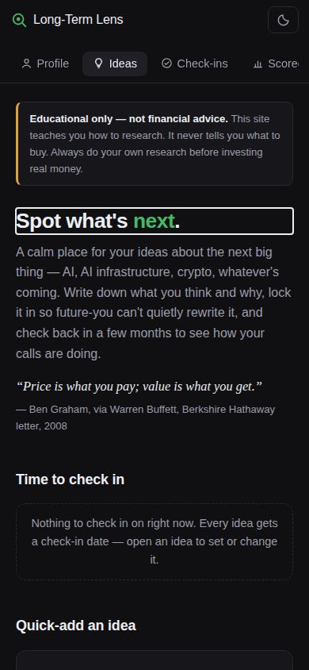
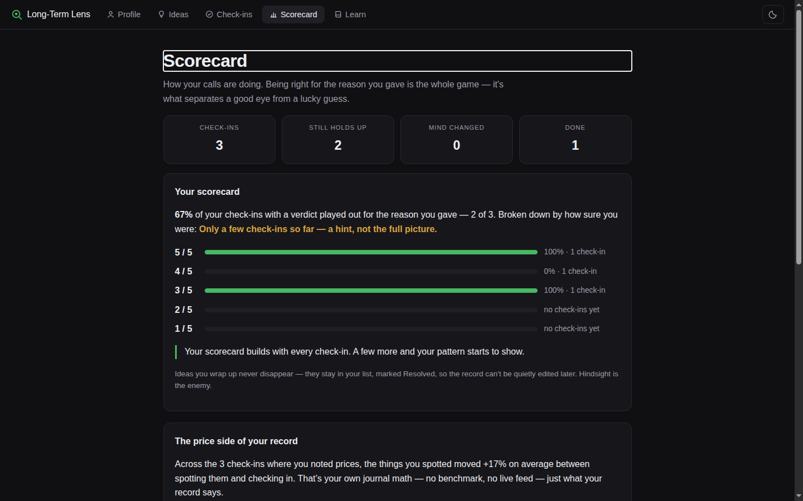

# Long-Term Lens

**Spot what's next — and keep score of your own calls.**

[](https://github.com/swimkevin/longterm-stock-lens/actions/workflows/test.yml)


**Live demo → https://swimkevin.github.io/longterm-stock-lens/**

I watched Bitcoin at ~$5,000 and thought "this will be huge" — then bought nothing. I watched AI coming for years, used it daily, and still didn't know *what* to invest in. The miss wasn't information. It was trust: I didn't know how much to trust my own gut, because I'd never kept score.

This is the tool that keeps score.

> **Educational only — not financial advice.** This app helps you organize and test your own thinking. It never tells you what to buy.

<!-- Screenshots: capture at 390px (mobile) and 1440px (desktop), save into docs/screenshots/, then uncomment.


-->

## What it does

A calm place for your ideas about the next big thing — AI, AI infrastructure, crypto, whatever's coming — in **five tabs: Profile · Ideas · Check-ins · Scorecard · Learn.** New visitors land on Profile first (your investor profile frames everything else); after that, the app opens on Ideas. Built around one loop:

1. **Spot it** — log a trend you're watching, or just name a company.
2. **Find companies** — each trend carries a ready-made prompt that maps it into categories and names the public companies in each (analysis only, never "buy this"). One tap turns a candidate into an idea, still linked to its trend.
3. **Write what you think** — two sentences: what happens, and what would change your mind. Optionally note the **price when you spotted it**. The first save **locks it all in** — timestamped, never editable again.
4. **Say how sure you are** — one tap, 1–5.
5. **Get a second opinion** — the app builds one prompt from everything you wrote; paste it into any AI for the numbers, the case for, the case against. It analyzes; it never says "buy."
6. **Check in** — any time you like (the date is just a nudge). The app shows you your own locked-in words — and the price then vs. now — and asks one question: *did it play out the way you said?*

Trends and ideas share the Ideas tab on purpose — a trend is just an idea before it has a company. Missed a wave? It goes in the same place, under **Missed waves**, with the lesson it taught you: your pattern library for the next one. The Learn tab carries the 13 micro-lessons plus the account basics — including the **2026 Roth IRA income window** ($153k–$168k single) and how pre-tax 401(k) contributions can legitimately bring you under it.

## The interesting part: the Scorecard

Ask a chat AI "was I right about Nvidia?" and it will happily reconstruct a story. It can't tell you what you *actually* wrote that day, how sure you were, or whether your 5-out-of-5 calls beat your 2-out-of-5s across two years of decisions. That takes a sealed, longitudinal record of your own judgment — which is exactly what this app keeps.

The **Scorecard** turns that record into hit rates by how sure you were, with honest presentation: every rate carries its count ("100% — 1 of 1"), small samples are labeled as hints rather than verdicts, and a plain-language read names your pattern. No AI can generate this data. It exists only if you kept the record.

## Engineering notes

- **Zero runtime dependencies, no build step.** One IIFE, vanilla JS + CSS custom properties. The whole app is `index.html` + `app.js` + `styles.css`, deployable to any static host.
- **Structure follows the funnel.** No dropdown menus, no buried pages: five always-visible tabs, trends merged into Ideas, accounts merged into Learn. A boot-time version check reloads the app once when a newer build exists, so a phone can never run a half-stale mix of old script and new page.
- **Local-first by design.** All data lives in `localStorage` (schema-versioned, with migrations from v1 journal formats forward). No accounts, no server, nothing to leak. Export to JSON/Markdown is built in.
- **Pure logic, tested in isolation.** Scoring, check-in scheduling, the scorecard math, sealing, and prompt building are pure functions exposed on `globalThis.LongTermLens`; rendering is a separate layer on top.
- **354 assertions, click-through included.** The jsdom suite boots the real page and *clicks through* the actual flows — adding ideas, locking in a thesis, checking in, XSS probes (all user text renders via `textContent` only), legacy-data migration, exports. Every fix ships with a regression test; CI runs the suite on every push.
- **Design system, not vibes.** Token-based theming (light/dark), one accent color, one primary action per view, hairline surfaces. The UI benchmark is Claude/Linear restraint: nothing on screen that doesn't earn its place.
- **Accessibility basics done properly:** focus rings, aria labels/pressed states, 44px targets, `prefers-reduced-motion`, keyboard shortcut (⌘K jumps to quick-add).

Details: [docs/ARCHITECTURE.md](docs/ARCHITECTURE.md) · [docs/TESTING.md](docs/TESTING.md) · [docs/ROADMAP.md](docs/ROADMAP.md) · [CHANGELOG.md](CHANGELOG.md)

## Run it locally

```bash
git clone https://github.com/swimkevin/longterm-stock-lens.git
cd longterm-stock-lens
python3 -m http.server 8000   # or any static server
# → http://localhost:8000

npm install   # dev-only: jsdom for the test suite
npm test      # 354 assertions
```

## Project layout

```
index.html        screens + static copy
app.js            data model, pure logic, rendering (one IIFE)
styles.css        design tokens + components
tests/smoke.js    jsdom assertion suite
docs/             architecture, testing, roadmap
```

## The hardest lesson: deleting

v1.x of this app had a research checklist, a weighted 0–100 scorecard, conviction labels, assumptions, and notes — nine sections per idea. Thorough, and nobody would ever use it. v2.0 deleted three scoring systems for a single 1–5 tap, and usage friction collapsed. The codebase still carries that discipline: dead code and stale layers get removed every few releases (the latest pass cut the entire legacy scoring engine, moving its one live job — migrating old data — into the loader where it belongs).

Every field is a tax on every future idea. The feature set stays small on purpose.

## Roadmap

Honest version: the Scorecard gets more valuable with every real check-in, and that takes calendar time, not code. Next up is in [docs/ROADMAP.md](docs/ROADMAP.md) — trends pattern library, optional cloud backup, and richer scorecard cuts once there's real data to cut.

---

Built by Kevin Song. Educational project — not financial advice, not a recommendation service, no real-time prices, ever.
